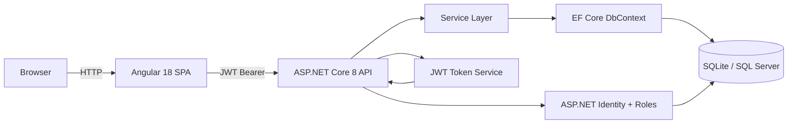

# Employee & Leave Management System

[](https://github.com/vinay-kumar-kaki/EmployeeManagementSystem/actions/workflows/ci.yml)


A production-shaped, full-stack employee portal built with **ASP.NET Core 8 Web API**, **Entity Framework Core**, **ASP.NET Core Identity + JWT**, **SQLite** (SQL Server switchable), and an **Angular 18** standalone SPA.

[Features](#features) · [Architecture](#architecture) · [Quick start](#quick-start) · [API](#api-endpoints) · [Testing](#testing) · [Resume highlights](#resume-highlights)

---

## Resume highlights

- Built a **role-based full-stack system** (Admin / Employee) with JWT authentication, ASP.NET Core Identity, and client-side route guards backed by server-side `[Authorize(Roles=...)]` enforcement.
- Implemented **complete HR workflows**: department & employee lifecycle, attendance check-in/out with work-duration calculation, leave application with overlap validation, and an admin review queue with approval/rejection remarks.
- Designed a **layered API** (Controllers → Services → EF Core DbContext) with DTOs, centralized error handling, and soft-delete semantics that preserve historical records.
- Added **live dashboards** with aggregated metrics and a headless-browser **E2E suite** plus a **Python API/database integration suite** (~60+ assertions total).
- Hardened sessions with **token validation on every request** (deactivated users are rejected even with a live JWT), server-authoritative `/auth/me` hydration, and configurable secrets.
- Set up **GitHub Actions CI** for both .NET and Angular builds; documented architecture, local setup, and security considerations.

---

## Features

| # | Feature | Backend | Frontend |
|---|---------|:-------:|:--------:|
| 1 | Admin & employee login with JWT + role claims | ✅ | ✅ |
| 2 | Server-authoritative current-user hydration (`/auth/me`) | ✅ | ✅ |
| 3 | Registration: admin-only + public employee self-service | ✅ | ✅ |
| 4 | Department create / edit / deactivate / list | ✅ | ✅ |
| 5 | Employee create / edit / search / deactivate / profile | ✅ | ✅ |
| 6 | Attendance check-in / check-out / history / admin log | ✅ | ✅ |
| 7 | Leave types: list, create, edit, deactivate / reactivate | ✅ | ✅ |
| 8 | Leave application with date + overlap validation | ✅ | ✅ |
| 9 | Admin leave review (approve / reject + remarks) | ✅ | ✅ |
| 10 | All-leaves audit view with status filter | ✅ | ✅ |
| 11 | Live admin & employee dashboards | ✅ | ✅ |
| 12 | Consistent API error payloads + global error interceptor | ✅ | ✅ |
| 13 | Deactivated users rejected on every authenticated request | ✅ | — |
| 14 | API + SQLite integration test | ✅ | — |
| 15 | Headless-browser frontend E2E test | ✅ | ✅ |

---

## Architecture



**Backend layers:** `Controllers` (routing / authorization) → `Services/Interfaces` + `Implementations` (business rules) → `Data/ApplicationDbContext` (persistence). Shared contracts live in `Models/DTOs`; domain objects in `Models/Entities`.

**Frontend layers:** `core/` (services, models, guards, interceptors) → `features/` (auth, dashboard, employees, departments, attendance, leaves, profile) → `shared/` (navbar). Every screen is a standalone Angular component.

See [docs/ARCHITECTURE.md](docs/ARCHITECTURE.md) for the detailed request flow.

---

## Quick start

### Prerequisites
- .NET 8 SDK
- Node.js 20+ and npm
- Python 3 (only for the API integration test)
- Chrome or Edge (only for the browser E2E test)

### 1. Backend

```powershell
cd backend/EmployeeManagementSystem.API
dotnet restore
dotnet run
```

API: `http://localhost:5120` · Swagger: `http://localhost:5120/swagger`

On first start the app creates and seeds the SQLite database: roles (`Admin`, `Employee`), an admin account, a **demo employee account**, 3 departments, and 3 leave types.

### 2. Frontend

```powershell
cd frontend
npm ci
npm start
```

SPA: `http://localhost:4200`

### Seeded accounts

| Role | Email | Password |
|------|-------|----------|
| Admin | `admin@company.com` | `admin@123` |
| Employee | `employee@company.com` | `employee@123` |

The login page has one-click quick-fill buttons for both accounts, plus a **Register** button for public employee self-registration.

### Configuration

`backend/EmployeeManagementSystem.API/appsettings.json` controls the database provider, JWT settings, and admin seed. For anything but local development, override secrets with environment variables:

```powershell
$env:JwtSettings__SecretKey = "<a-long-random-secret-at-least-32-characters>"
$env:AdminSeed__Password    = "admin@123" # demo value; use a strong password in real deployments
```

The seeded admin and demo-employee passwords are re-synced from configuration on every startup, so changing `AdminSeed__Password` and restarting updates the live login.
The app logs a warning at startup if the development JWT key is still in use.

---

## Frontend routes

| Route | Access | Purpose |
|-------|--------|---------|
| `/login` | Public | Login (quick-fill + Register button) |
| `/register` | Public | Employee self-registration |
| `/dashboard` | Authenticated | Role-specific dashboard |
| `/employees`, `/employees/new`, `/employees/:id/edit` | Admin | Employee directory / forms |
| `/departments` | Admin | Department management |
| `/leaves/review` | Admin | Pending queue + all requests + status filter |
| `/leave-types` | Admin | Leave type CRUD |
| `/admin/register` | Admin | Create another admin |
| `/attendance/log` | Admin | Company-wide daily attendance |
| `/leaves/apply`, `/leaves/history` | Employee | Leave workflow |
| `/attendance` | Employee | Check-in / check-out / history |
| `/profile` | Employee | Personal profile |

---

## API endpoints

### Auth (`/api/auth`)
| Method | Endpoint | Access | Description |
|--------|----------|--------|-------------|
| POST | `/login` | Public | JWT + role + employeeId |
| POST | `/register` | Public | Self-register an Employee account + JWT |
| POST | `/register-admin` | Admin | Create another admin |
| GET | `/me` | Authenticated | Current user from server |

### Departments (`/api/department`) · Employees (`/api/employee`)
`GET /`, `GET /{id}`, `POST /`, `PUT /{id}`, `DELETE /{id}` (soft deactivate). Employees also expose `GET /profile/me` and search via `GET /?search=&departmentId=`.

### Attendance (`/api/attendance`)
`GET /today-status`, `POST /check-in`, `POST /check-out`, `GET /my-history`, `GET /all?date=YYYY-MM-DD` (Admin).

### Leaves (`/api/leave`)
| Method | Endpoint | Access | Description |
|--------|----------|--------|-------------|
| GET | `/types`, `/types/all` | Auth / Admin | Active types / all types |
| POST | `/types`, PUT `/types/{id}`, DELETE `/types/{id}` | Admin | Leave type CRUD |
| POST | `/apply`, GET `/my-history` | Auth | Employee leave workflow |
| GET | `/pending`, `/all` | Admin | Review queues |
| PUT | `/{id}/review` | Admin | Approve / reject + remarks |

Status codes: `0 = Pending`, `1 = Approved`, `2 = Rejected`.

### Dashboard (`/api/dashboard`)
`GET /admin-stats`, `GET /employee-stats`.

---

## Testing

```powershell
# Build verification
dotnet build backend/EmployeeManagementSystem.API/EmployeeManagementSystem.API.csproj
cd frontend; npm run build
```

With the backend running:

```powershell
python tests/integration_test.py      # API + direct SQLite assertions
node tests/e2e/frontend_e2e.js        # Headless browser UI + API persistence
```

Or from the frontend folder: `npm run test:api` / `npm run test:e2e`.

Both scripts use unique run-id suffixes, so they are safe to run repeatedly. The browser test uses the `ws` package declared in `frontend/package.json`; set `EMS_BROWSER` if Chrome/Edge is not auto-detected.

CI runs both builds on every push / PR via [.github/workflows/ci.yml](.github/workflows/ci.yml).

---

## Publishing to GitHub

The project is published at https://github.com/vinay-kumar-kaki/EmployeeManagementSystem. To push future changes:

```powershell
git add .
git commit -m "Describe your change"
git push origin main
```

For a fresh clone:

```powershell
git clone https://github.com/vinay-kumar-kaki/EmployeeManagementSystem.git
```

Generated folders (`node_modules`, `dist`, `.angular`, `bin`, `obj`), the SQLite database, and logs are excluded by [.gitignore](.gitignore).

---

## Deploying to Render

The included [render.yaml](render.yaml) Blueprint deploys **one Docker web service** that serves both the ASP.NET Core API and the built Angular SPA from the same origin.

1. Push this repository to GitHub (see above).
2. In Render, choose **New → Blueprint** and connect the repository. Render reads `render.yaml` and creates the service automatically.
3. `AdminSeed__Password` is set to the demo value `admin@123` in `render.yaml` (change it for real deployments); the JWT secret is generated automatically.
4. Render builds the Docker image and deploys. Future pushes to `main` are deployed automatically **after GitHub Actions CI passes** (`autoDeployTrigger: checksPass`).
5. Open the service's `onrender.com` URL. The seeded accounts from [Quick start](#seeded-accounts) work, and **Register** on the login page creates additional employee accounts.

Notes:
- The free plan spins the service down after inactivity; the first request after idle may take ~30–60 seconds.
- Free services have an **ephemeral filesystem**, so the SQLite database is reset on each deploy/restart. For persistence, upgrade the web service to a paid plan and add a disk mounted at `/app/data`, then set `ConnectionStrings__SqliteConnection` to `Data Source=/app/data/EmployeeManagement.db`.
- For production, also override `AdminSeed__Email` and review CORS/JWT settings in `Program.cs` / `appsettings.json`.

---

## Security notes

- JWT bearer tokens expire after 120 minutes (`JwtSettings:DurationInMinutes`).
- Passwords require 8+ characters with lowercase, digit, and symbol (uppercase is optional for the documented demo credentials).
- Public `/register` creates **Employee** accounts only; admin registration remains restricted to authenticated admins.
- `OnTokenValidated` rejects tokens belonging to soft-deactivated employees.
- The demo passwords (`admin@123` / `employee@123`) are for local/demo use. Replace the JWT secret and admin password before any real deployment. For stricter auditing, add a per-request check for admin role changes.

## License

[MIT](LICENSE)
